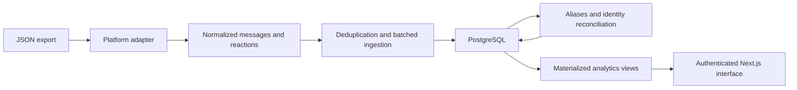

# Groupchat Analytics Engine

A privacy-safe technical case study of Groupchat Wrapped, a private full-stack chat analytics project by Tahmudun Nabi.

**This repository contains newly written documentation and entirely fictional examples.** The original source, conversations, participant identities, statistics, media and operational records remain private. This is not a runnable release or a copy of the private repository.

## The engineering problem

Exported conversations are difficult to analyze reliably: repeated exports overlap, display names drift, reactions refer to messages, and derived statistics must remain consistent after identity corrections. The project combines ingestion, identity reconciliation, database-backed analytics and an authenticated interface.

## Implemented in the private project

Source inspection confirms an Instagram adapter, batched ingestion with conflict handling, member aliases and mention resolution, a member merge workflow with preview and transactional updates, PostgreSQL materialized analytics views, search, authentication and rate limiting, admin tools, and automated tests. The frontend uses Next.js and TypeScript; data storage uses PostgreSQL with Supabase integration and subsequent self-hosting infrastructure work.

## Identity correction example

The [fictional example](examples/identity-drift.json) shows one invented participant using two display names. A merge preview estimates affected records; a confirmed merge reassigns references and resolves duplicates before derived analytics are refreshed. Preserving message identifiers avoids a broad primary-key rewrite, but a later export under another name can require reconciliation again. That tradeoff is part of the implemented design, rather than a claim that identity resolution is solved universally.

## Privacy and operational boundaries

A public demo must use independently invented data in a separate database. Removing names from real messages or reproducing real aggregate statistics is insufficient. This case study publishes neither. Long-running administrative pipelines require a persistent local process; an in-process job registry does not survive arbitrary serverless termination. Infrastructure migration is ongoing; no public deployment or complete cross-platform ingestion support is claimed.

## Validation and limits

The case study was checked against private ingestion, merge, authentication, search and migration source, without copying that source. Its JSON example is validated as fictional and structurally consistent. Private runtime tests were not rerun for this documentation-only publication. No participant counts, performance figures or accuracy metrics are published.

## Authorship

Tahmudun Nabi designed, directed, debugged, tested and integrated the system using AI-assisted development with Claude Code and Codex. This showcase describes engineering decisions and implemented components while preserving the private project's data boundary.
