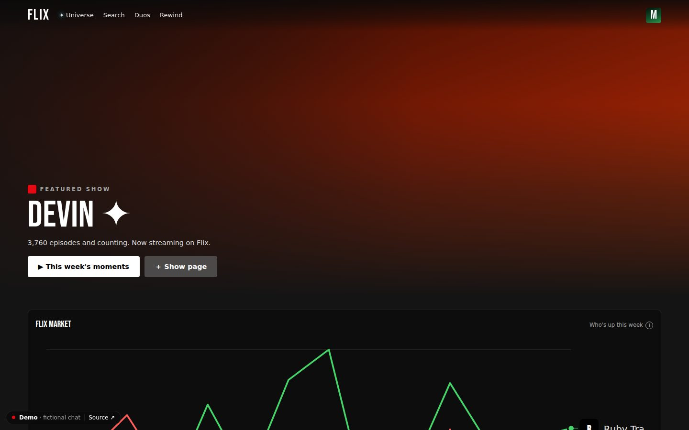
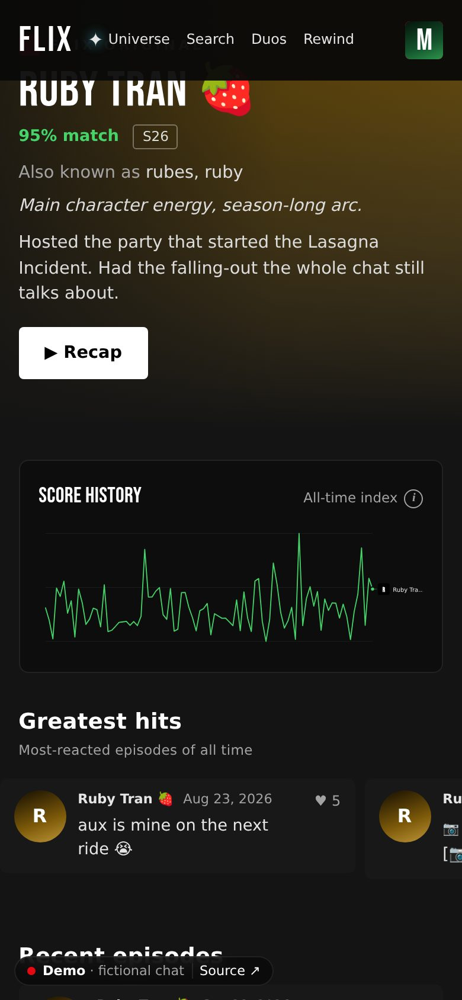
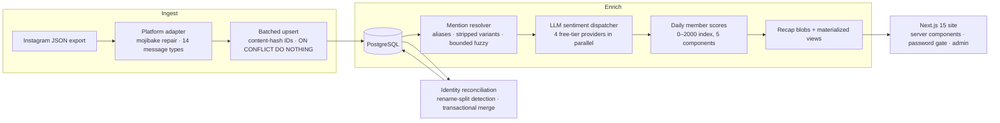
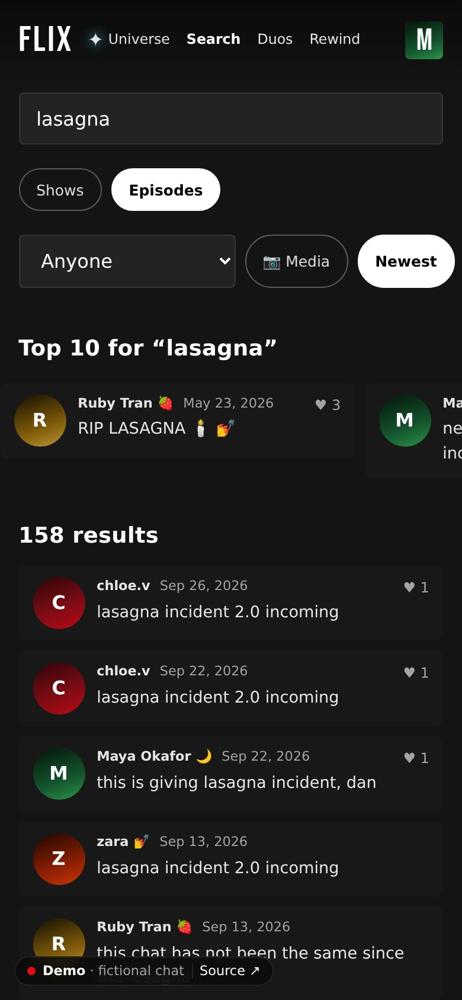
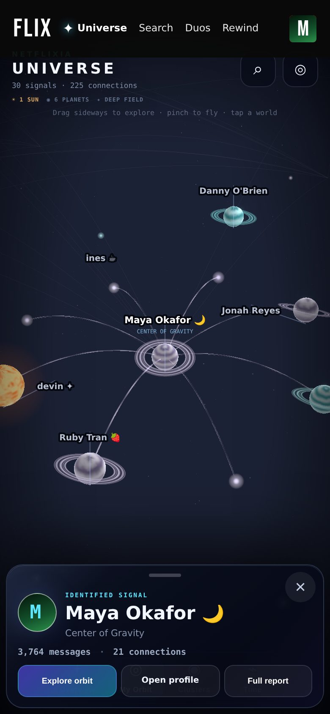

# Groupchat Wrapped

**A data pipeline and analytics site for group-chat exports, presented as a streaming service.** Members are
"shows", messages are "episodes", and a nightly pipeline turns a raw Instagram export into daily member
scores, a stock-market-style chart, Netflix-style category rows and a Spotify-Wrapped-style recap for each person.

**Live demo:** [groupchat-wrapped-demo.vercel.app](https://groupchat-wrapped-demo.vercel.app). It's a fully fictional chat,
generated by this repo and analyzed by the same pipeline.

<p>
  
  
</p>

The original runs privately on a real friend group's chat: about 1M messages, 0.9M reactions and ~860
senders over about six and a half months. Every name and message in this repo, its screenshots and the demo
comes from a **synthetic** chat ([below](#synthetic-data-a-fictional-chat-as-a-benchmark)). The only facts
from the real chat are aggregate pipeline metrics (sizes, run times, counts), and no real conversation data is
published.

---

## Architecture



| Layer | Stack |
|---|---|
| Ingestion & CLI | TypeScript (strict), Node 22, `pnpm wrapped <command>`; the original v0 ingester in Python |
| Storage | PostgreSQL 16 (Supabase in production, plain Postgres/Neon for the demo): numbered additive migrations, materialized views, `pg_trgm` |
| Enrichment | Groq / Mistral / Gemini / Cerebras free tiers (Ollama locally), Zod-validated contracts |
| Serving | Next.js 15 App Router on Vercel, edge middleware with HMAC session cookies, argon2id |
| Tests | Vitest, 453 tests: adapters, resolver, sentiment contract, scoring, merge, synthetic generator |

## Engineering highlights

### 1. Idempotent ingestion across overlapping exports
Instagram exports are full-history snapshots, so every new export overlaps the last. Message IDs are a
content hash of `(sender, timestamp_ms, content)`, inserted with `ON CONFLICT DO NOTHING`, so re-ingesting an
export inserts zero rows. The TypeScript adapter is byte-for-byte compatible with the original Python
parser's IDs (5,000/5,000 golden-hash parity against the existing rows). It also repairs Instagram's
latin-1-mangled UTF-8 and sorts rows into 14 message types, so system events stay out of the analytics.

### 2. Identity reconciliation: the display-name drift problem
Instagram relabels a person's **entire history** with whatever display name they have at export time. One
rename turns one member into two, and because the name is part of the content hash, their old messages
come back as "new" duplicates. Detection uses trigram similarity over member names. The merge, run inside one
transaction, collapses true duplicates on `(timestamp_ms, content)`, reassigns sender, reactor, mention and
sentiment references, keeps the old name as an alias, and refreshes every dependent view. The synthetic chat
reproduces this on purpose: the second export dedups 23,156 of 24,213 overlapping messages, the 1,057 that
don't are the renamed member's history, and the merge removes exactly those 1,057.

### 3. Serving fast on a free tier
The free-tier database enforced a 3-second statement timeout on public requests, and a full aggregate over
~900k rows took ~12 seconds even when fully cached. Every hot path was rebuilt to do small, index-bounded
work:
- Materialized views for per-sender and per-message reaction counts, refreshed concurrently by every ingest
- Pagination counts capped at 10,001 rows ("10,000+") and run through per-shape dynamic SQL
- Five iterations of the search query, from a CTE seq-scan to split fast/reaction paths

### 4. LLM sentiment at scale, on free API tiers
- **Compressed contract.** The model returns only `[index, member, score]` triples, and labels are derived
  client-side. This cut response tokens by ~60%.
- **Multi-provider dispatcher.** Four providers run in parallel with per-lane RPM/TPM/daily budgets,
  backoff and graceful shutdown. Results are cached by `model_version`, so no lane ever redoes another's work.
- **Echo matching.** Models echo names back wrong (decorated names, `user (as "alias")` labels, garbled
  spellings), so a tolerant matching cascade maps each echo back to the right member, with ambiguity guards.
- **Result.** All 66,013 mention pairs classified in 105 minutes across 4 lanes. 13 pairs (0.02%) were
  unparseable and stored as neutral placeholders.
- **Calibration gate.** Before a full run, each lane must correlate with a reference model on daily means
  (r ≥ 0.8).

### 5. Measuring data quality instead of eyeballing it
Mention resolution started at 201k flagged messages and was tuned on live data to 42.9k. The fixes were
stopword and short-alias policies, tighter fuzzy matching, negation-contraction handling, and blocklists for
names that are everyday words. The synthetic chat turns this into a benchmark: the generator records who each
message was really about and how it felt, and `synth eval` scores the real resolver and every sentiment model
against that ground truth. Current resolver numbers: **precision 0.918, recall 0.962**.
- **False positives:** exactly the four planted everyday-word nicknames ("abs", "mayo", "leo", "dev").
- **False negatives:** mostly a 2-letter nickname, below the resolver's minimum alias length.

### 6. Operating it
Incidents on the way:
- **Orphaned query.** A killed CLI job left its server-side query running for 2½ hours, which drained the
  database's disk-I/O burst budget. The lesson: check `pg_stat_activity` after any aborted heavy job.
- **Connection-slot exhaustion.** Serverless functions held the session pooler's 15 slots until it ran out;
  the fix was the transaction pooler with prepared statements disabled.
- **Dropped timeout.** The pooler silently dropped `statement_timeout` from connection parameters, so only
  an explicit `SET` sticks.

Each fix shipped with a write-up.

### 7. Privacy by design
- The real data never leaves its private database.
- The public demo runs on a separate database that holds only generated data.
- The demo server refuses to start unless the chat it renders is flagged synthetic, so a misconfigured deploy
  fails closed instead of publishing anything.
- The legacy public API path was revoked at the database level, including `SECURITY DEFINER` functions that
  bypassed row-level security.

## Synthetic data: a fictional chat as a benchmark

`pnpm wrapped synth generate` simulates a season of a fictional 30-person group chat, from a seed so the
output is reproducible:
- **Messages:** a Poisson number of conversations per day, time-of-day chronotypes, closeness-weighted turn
  taking with double-texts, and heavy-tailed gaps between messages.
- **Reactions and media**, plus a storyline: a birthday, a member joining and another fading out, a fantasy-league
  rivalry, a falling-out and reconciliation, finals week, a group trip, and the Lasagna Incident.
- **Output:** genuine Instagram archives (newest-first, mojibake-encoded, ASCII-escaped JSON), written as
  two exports either side of a display-name change.

The pipeline doesn't know the data is fake. It ingests, dedups, merges, resolves mentions, classifies
sentiment and scores it like the real thing, and the arcs come out in the analytics on their own:

<p>
  
  
  
  
</p>

## Run it locally

Requires Node 22, pnpm and a PostgreSQL 16 database you can write to.

```bash
cd engine && pnpm install
export DATABASE_URL=postgresql://localhost:5432/wrapped_demo

pnpm wrapped db bootstrap                  # schema + migrations on an empty database
pnpm wrapped synth generate                # fictional chat → Instagram-format exports + ground truth
pnpm wrapped synth load                    # real ingest path, rename merge, nickname curation
pnpm wrapped mentions extract --chat=binge-club
pnpm wrapped sentiment dispatch --chat=binge-club   # needs GROQ/MISTRAL/GEMINI/CEREBRAS keys…
#   …or, without keys: pnpm wrapped synth oracle   (ground-truth sentiment, local testing only)
pnpm wrapped scores compute --chat=binge-club       # scores → recap → materialized views
pnpm wrapped synth eval                    # resolver + sentiment accuracy vs ground truth

pnpm build && DEMO_MODE=true FLIX_CHAT=binge-club pnpm start   # http://localhost:3000
pnpm test                                  # 453 tests (DATABASE_URL must be set; tests don't touch it)
```

Every command is documented in [`engine/CLI.md`](engine/CLI.md), and operator notes are in
[`engine/README.md`](engine/README.md).

## Layout

```
engine/
  lib/adapters/     platform adapters (Instagram; WhatsApp/Discord/Messenger stubs)
  lib/ingestion/    batched idempotent ingest + cache refresh
  lib/mentions/     alias-based mention resolver
  lib/sentiment/    LLM contract, parsing/repair cascade
  lib/dispatch/     multi-provider rate-limited dispatcher + calibration
  lib/scoring/      daily member score formula + compute
  lib/recap/        per-member Wrapped-style stats
  lib/synth/        synthetic chat generator, exporter, ground-truth eval
  lib/admin/        merge, aliases, uploads, job registry
  app/              Next.js site, admin, JSON API
  supabase/migrations/   numbered additive migrations (100+)
  tests/            Vitest suite
search-engine/      the original v0: Python ingester + base schema
```

---

Designed and built by Tahmudun Nabi, with AI pair-programming (Claude Code and Codex) for implementation,
review and testing. [MIT licensed](LICENSE).
